<!-- Every card below is an animated SVG drawn by scripts/render_cards.py (Python standard library; no third-party widget services, no trackers, no
     JavaScript) and redrawn daily by .github/workflows/update-cards.yml. Dark and light variants come as <picture> pairs. The mark is the wordmark's lambda inside a
     hexagon, its right leg breaking out as the red sting; the red star is Antares (the heart of Scorpius). Colours: the Antaryx desktop palette. Spacing is baked into the SVGs: keep the images of a row on one line, no spaces. -->

<picture><source media="(prefers-color-scheme: light)" srcset="./cards/hero-light.svg"></picture> 
<picture><source media="(prefers-color-scheme: light)" srcset="./cards/whoami-light.svg"></picture> 
<picture><source media="(prefers-color-scheme: light)" srcset="./cards/blue-light.svg"></picture><picture><source media="(prefers-color-scheme: light)" srcset="./cards/red-light.svg"></picture> 
<picture><source media="(prefers-color-scheme: light)" srcset="./cards/divider-light.svg"></picture>

<picture><source media="(prefers-color-scheme: light)" srcset="./cards/h-log-light.svg"></picture> 
<a href="https://github.com/antaryx/plumbline"><picture><source media="(prefers-color-scheme: light)" srcset="./cards/plumbline-light.svg"></picture></a><a href="https://github.com/antaryx/plumbline-action"><picture><source media="(prefers-color-scheme: light)" srcset="./cards/plumbline-action-light.svg"></picture></a> 
<picture><source media="(prefers-color-scheme: light)" srcset="./cards/h-scan-light.svg"></picture> 
<picture><source media="(prefers-color-scheme: light)" srcset="./cards/replay-light.svg"></picture> 
<picture><source media="(prefers-color-scheme: light)" srcset="./cards/activity-light.svg"></picture> 
<picture><source media="(prefers-color-scheme: light)" srcset="./cards/stack-light.svg"></picture> 
<picture><source media="(prefers-color-scheme: light)" srcset="./cards/h-method-light.svg"></picture> 
<picture><source media="(prefers-color-scheme: light)" srcset="./cards/method-light.svg"></picture> 
<picture><source media="(prefers-color-scheme: light)" srcset="./cards/rules-light.svg"></picture> 
<picture><source media="(prefers-color-scheme: light)" srcset="./cards/h-feed-light.svg"></picture> 
<picture><source media="(prefers-color-scheme: light)" srcset="./cards/threat-light.svg"></picture> 
<picture><source media="(prefers-color-scheme: light)" srcset="./cards/h-stars-light.svg"></picture> 
<picture><source media="(prefers-color-scheme: light)" srcset="./cards/starmap-light.svg"></picture> 
<picture><source media="(prefers-color-scheme: light)" srcset="./cards/h-lab-light.svg"></picture> 
<picture><source media="(prefers-color-scheme: light)" srcset="./cards/lablog-light.svg"></picture>

 

> *"The most dangerous vulnerabilities are the ones that cast no shadow."*

<code>>_ cat /etc/operational_matrix.conf</code>

 

**Operating in the void between defensive architecture and offensive exploitation.** **Antaryx** is a hybrid security research node dedicated to stealth automation, digital forensics and advanced payload engineering. I do not just monitor the perimeter; I become the noise to understand the threat.

| `[ DEFENSE_VECTORS // BLUE TEAM ]` | `[ OFFENSE_VECTORS // RED TEAM ]` |
|---|---|
| **Anomaly detection:** parsing the void for unauthorized telemetry and anomalous behaviours. | **Vulnerability research:** dissecting logic flaws, misconfigurations and system weaknesses. |
| **Forensic architecture:** reconstructing fragmented digital footprints and auditing access logs. | **Payload engineering:** crafting silent, adaptive execution chains. |
| **System hardening:** architecting impenetrable WSL / Linux environments and secure containerised infrastructure. | **Stealth operations:** bypassing static analysis through behavioural mutation and footprint reduction. |

> [!IMPORTANT]
> Offensive work happens only against targets I am authorized to test: HackTheBox, TryHackMe, CTF platforms and my own lab. Nothing here is a tool for anyone else's systems.

<picture><source media="(prefers-color-scheme: light)" srcset="./cards/h-net-light.svg"></picture> 
<a href="https://app.hackthebox.com/users/3514431"><picture><source media="(prefers-color-scheme: light)" srcset="./cards/btn-htb-light.svg"></picture></a><a href="https://tryhackme.com/p/antaryx"><picture><source media="(prefers-color-scheme: light)" srcset="./cards/btn-thm-light.svg"></picture></a><a href="mailto:antaryx@proton.me"><picture><source media="(prefers-color-scheme: light)" srcset="./cards/btn-mail-light.svg"></picture></a> 
<picture><source media="(prefers-color-scheme: light)" srcset="./cards/footer-light.svg"></picture> 
cards drawn by <a href="./scripts/render_cards.py"><code>scripts/render_cards.py</code></a> and redrawn daily: no third-party widgets, no trackers, no JavaScript

