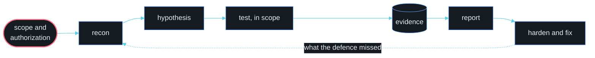

<!-- Every card below is an animated SVG drawn by scripts/render_cards.py (Python standard library, no third-party widget services, no trackers)
     and refreshed weekly by .github/workflows/update-cards.yml. The scorpion is Scorpius; the red star is Antares. Colours: the Antaryx desktop palette.
     Spacing is baked into the SVGs: keep the images of a row on one line with no spaces between them. -->

 
 
 

### `>_ git log --author=antaryx --stat`

 
 

### `>_ cat /etc/method`

 

> *"The most dangerous vulnerabilities are the ones that cast no shadow."*

<code>>_ cat /etc/operational_matrix.conf</code>

 

**Operating in the void between defensive architecture and offensive exploitation.** **Antaryx** is a hybrid security research node dedicated to stealth automation, digital forensics and advanced payload engineering. I do not just monitor the perimeter; I become the noise to understand the threat.

| `[ DEFENSE_VECTORS // BLUE TEAM ]` | `[ OFFENSE_VECTORS // RED TEAM ]` |
|---|---|
| **Anomaly detection:** parsing the void for unauthorized telemetry and anomalous behaviours. | **Vulnerability research:** dissecting logic flaws, misconfigurations and system weaknesses. |
| **Forensic architecture:** reconstructing fragmented digital footprints and auditing access logs. | **Payload engineering:** crafting silent, adaptive execution chains. |
| **System hardening:** architecting impenetrable WSL / Linux environments and secure containerised infrastructure. | **Stealth operations:** bypassing static analysis through behavioural mutation and footprint reduction. |

> [!IMPORTANT]
> Offensive work happens only against targets I am authorized to test: HackTheBox, TryHackMe, CTF platforms and my own lab. Nothing here is a tool for anyone else's systems.

### `>_ netstat -ano | grep ESTABLISHED`

*Establish a secure handshake via encrypted channels, or follow the training nodes:*

&nbsp;&nbsp;&nbsp;&nbsp;

 

cards drawn by <a href="./scripts/render_cards.py"><code>scripts/render_cards.py</code></a> and refreshed weekly: no third-party widgets, no trackers, no JavaScript

